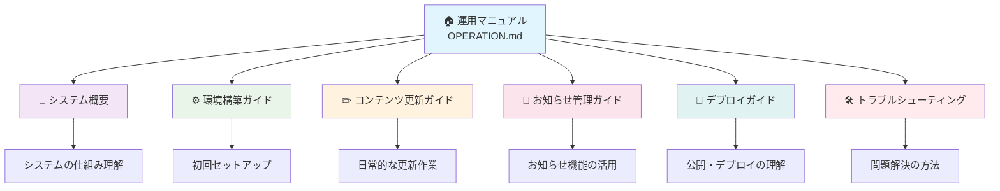

# 松ケ丘小学校おやじの会 - ウェブサイト運用マニュアル

このマニュアルは、プログラマーでない方でもウェブサイトの運用・更新ができるように作成されています。
手順に従って作業することで、安全にサイトを更新することができます。

## 📚 ドキュメント構成

運用マニュアルは以下のように分割されており、必要な部分から読み進めることができます：

## 🚀 クイックスタートガイド

### 👋 初めての方

ウェブサイト運用が初めての方は、この順序で読み進めることをお勧めします：

1. **📖 [システム概要](./docs/manual/01-system-overview.md)** （20分）
   - ウェブサイトの仕組みを理解する
   - 全体像を把握する

2. **⚙️ [環境構築ガイド](./docs/manual/02-environment-setup.md)** （60分）
   - 必要なソフトウェアをインストール
   - 作業環境を整える

3. **✏️ [コンテンツ更新ガイド](./docs/manual/03-content-management.md)** （30分）
   - 基本的な編集方法を学ぶ
   - 実際に練習してみる

### 🔄 既に環境がある方

すでに開発環境が構築済みの方は、目的に応じて必要な部分をご覧ください：

| 目的 | 参照ドキュメント | 所要時間 |
|------|------------------|----------|
| 📝 **ページ内容の更新** | [コンテンツ更新ガイド](./docs/manual/03-content-management.md) | 15分 |
| 📢 **お知らせの追加・編集** | [お知らせ管理ガイド](./docs/manual/04-announcements.md) | 10分 |
| 🚀 **サイトの公開方法** | [デプロイガイド](./docs/manual/05-deployment.md) | 15分 |
| 🐛 **問題の解決** | [トラブルシューティング](./docs/manual/06-troubleshooting.md) | 随時 |

## 📖 詳細マニュアル

### 1. 📊 [システム概要・アーキテクチャ](./docs/manual/01-system-overview.md)

ウェブサイトの全体的な仕組みと、各コンポーネントの役割を理解します。

**📋 含まれる内容:**
- システム全体の構成図
- ローカル環境、GitHub、GitHub Pages の役割
- VitePress の特徴と利点
- ワークフロー（作業の流れ）
- セキュリティと安全性

**👥 対象者:** 全員（特に初回利用者）

---

### 2. ⚙️ [環境構築ガイド](./docs/manual/02-environment-setup.md)

ウェブサイトの編集・更新に必要なソフトウェアの導入と設定を行います。

**📋 含まれる内容:**
- 必要なソフトウェア一覧
- Windows・Mac 別のインストール手順
- プロジェクトのセットアップ
- ローカル開発環境の起動方法
- インストール確認チェックリスト

**👥 対象者:** 初回セットアップを行う方、新しいPCで作業する方

---

### 3. ✏️ [コンテンツ更新ガイド](./docs/manual/03-content-management.md)

ページ内容の編集、画像の追加、PDFファイルの管理方法を学びます。

**📋 含まれる内容:**
- マークダウン記法の基本
- 既存ページの編集方法
- 画像の最適化と追加
- PDFファイルの管理
- 変更のアップロード方法

**👥 対象者:** 日常的にコンテンツを更新する方

---

### 4. 📢 [お知らせ管理ガイド](./docs/manual/04-announcements.md)

お知らせ機能の詳細な使い方と効果的な運用方法を説明します。

**📋 含まれる内容:**
- お知らせシステムの仕組み
- ファイル構成と命名規則
- お知らせの種類（warning, info, tip, danger）
- 新規作成・編集・削除の方法
- 表示制御機能（visible設定）
- 運用のベストプラクティス

**👥 対象者:** お知らせを投稿・管理する方

---

### 5. 🚀 [デプロイガイド](./docs/manual/05-deployment.md)

ローカルで編集した内容を本番サイトに公開する方法を詳しく説明します。

**📋 含まれる内容:**
- デプロイの仕組みと種類
- 自動デプロイのフロー
- 手動デプロイの方法
- GitHub Actions の監視
- デプロイのベストプラクティス
- パフォーマンス管理

**👥 対象者:** サイト公開の責任者、技術的な理解を深めたい方

---

### 6. 🛠️ [トラブルシューティング](./docs/manual/06-troubleshooting.md)

よくある問題とその解決方法、緊急時の対応方法をまとめています。

**📋 含まれる内容:**
- 問題診断のフローチャート
- ローカル環境の問題解決
- GitHub・認証の問題
- 本番サイトの問題
- 予防・メンテナンス方法
- サポート依頼時の注意事項

**👥 対象者:** 問題に遭遇した時、予防策を学びたい方

## 🎯 よくあるタスク別ガイド

### 📝 新しいお知らせを投稿したい

1. **📢 [お知らせ管理ガイド](./docs/manual/04-announcements.md)** の「新規お知らせの作成」を参照
2. ファイルを作成・編集
3. **🚀 [デプロイガイド](./docs/manual/05-deployment.md)** でアップロード方法を確認

### 🖼️ イベント写真を追加したい

1. **✏️ [コンテンツ更新ガイド](./docs/manual/03-content-management.md)** の「画像の管理」を参照
2. 画像を最適化
3. 適切なフォルダに保存
4. マークダウンで表示設定

### 📄 おやじの会通信を更新したい

1. **✏️ [コンテンツ更新ガイド](./docs/manual/03-content-management.md)** の「おやじの会通信の更新」を参照
2. PDFファイルを `public/letter/` に保存
3. `letters.md` にリンクを追加

### 🚨 サイトに問題が発生した

1. **🛠️ [トラブルシューティング](./docs/manual/06-troubleshooting.md)** で該当する問題を検索
2. 解決方法を実行
3. 解決しない場合はサポートに連絡

---

*最終更新: 2025年9月11日*
