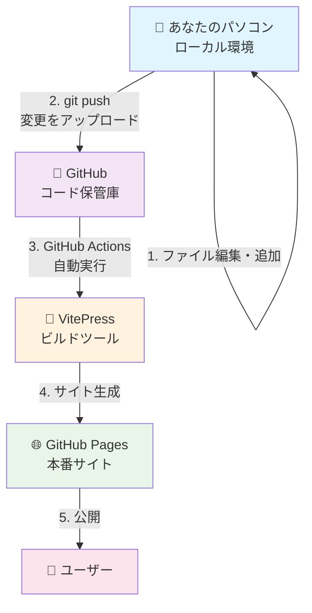
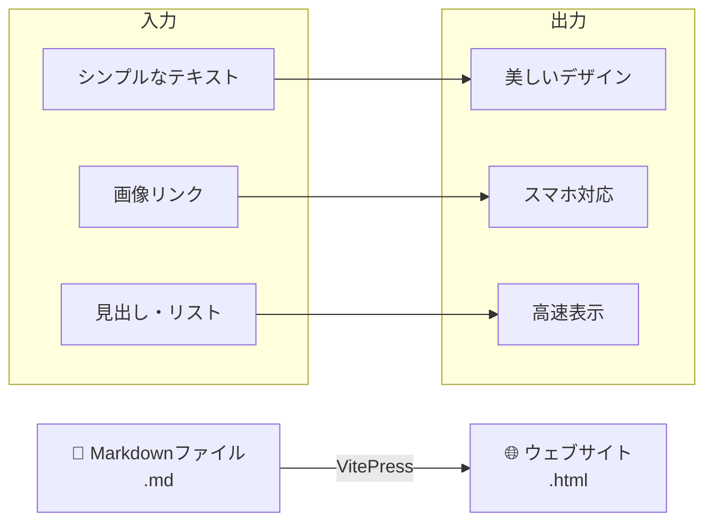
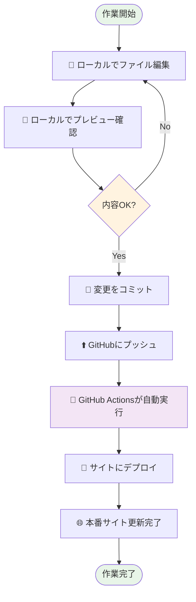

# システム概要・アーキテクチャ

## システム全体の構成図



## 各コンポーネントの詳細

### 🖥️ ローカル環境（あなたのパソコン）

**役割**: サイトの内容を編集・確認する作業場所

**できること**:
- 📝 記事の編集・作成
- 🖼️ 画像の追加・管理  
- 👀 変更内容のプレビュー確認
- 🧪 エラーチェック

**主な作業内容**:
```
記事作成 → プレビュー確認 → GitHubにアップロード
```

### 📁 GitHub（コード保管庫）

**役割**: ファイルを安全に保管し、変更履歴を管理する

**主な機能**:

| 機能 | 説明 | メリット |
|------|------|----------|
| 🔒 **ファイルバックアップ** | すべてのファイルをクラウドに保存 | データ紛失防止 |
| 📜 **変更履歴管理** | いつ・誰が・何を変更したか記録 | 間違いがあっても元に戻せる |
| 👥 **共同作業** | 複数人で同じプロジェクトを編集 | チームでの更新作業 |
| 🤖 **自動デプロイ** | ファイル更新時に自動でサイト更新 | 手動作業不要 |

### 🌐 GitHub Pages（本番サイト）

**役割**: 実際にインターネットで公開されるウェブサイト

**詳細情報**:
- **URL**: https://matsu-oyaji.github.io/
- **更新タイミング**: GitHubへのアップロード後、約5-10分で自動更新
- **アクセス**: 24時間いつでも世界中からアクセス可能

### 🔧 VitePress（サイト生成ツール）

**役割**: マークダウンファイル（.md）を美しいウェブサイトに変換

**特徴**:



**VitePressの利点**:
- ⚡ **高速**: ページの読み込みが早い
- 📱 **レスポンシブ**: PC・スマートフォン両対応
- 🔍 **SEO対応**: 検索エンジンに見つけやすい
- 🎨 **モダンデザイン**: 現代的で美しい見た目
- 🔧 **メンテナンス性**: 更新・修正が簡単

## ワークフロー（作業の流れ）



## ファイル種別と役割

### 📄 マークダウンファイル（.md）
サイトのページ内容を記述するファイル

```markdown
# 見出し
## 小見出し

**太字** *斜体*

- リスト1
- リスト2

[リンク](https://example.com)

```

### 🖼️ 静的ファイル（画像・PDF等）
`public/` フォルダに保存される資料ファイル

```
public/
├── img/          # 一般的な画像
├── event/        # イベント関連資料
├── letter/       # おやじの会通信
└── docs/         # PDF文書
```

### ⚙️ 設定ファイル
サイトの動作や見た目を制御するファイル

```
.vitepress/
├── config.ts     # サイト全体の設定
└── theme/        # デザインカスタマイズ
```

## セキュリティと安全性

### 🔒 データ保護
- すべての変更はGitHubに履歴として保存
- 間違った変更は簡単に元に戻せる
- 複数のバックアップが自動作成

### 👥 アクセス制御
- GitHub アカウントによる認証
- 権限のあるユーザーのみ編集可能
- 変更者の記録を自動保存

### 🛡️ 障害対策
- GitHub の高い可用性（99.9%稼働率）
- 自動バックアップ
- 複数地域でのデータ複製

## 次のステップ

システム概要を理解したら、次は実際の環境構築に進みましょう：

➡️ [環境構築ガイド](./02-environment-setup.md)
