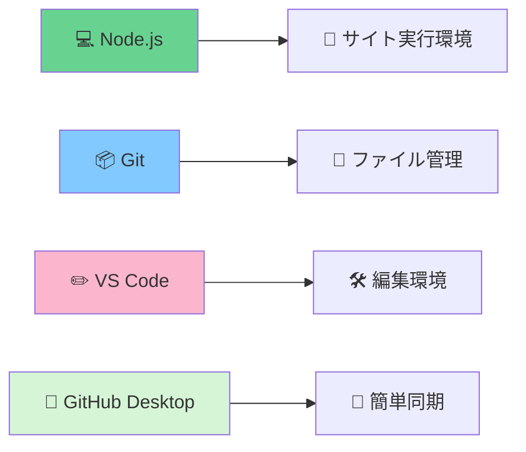
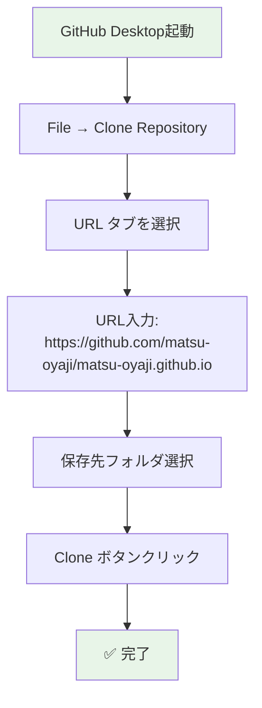

# 環境構築ガイド

このガイドでは、ウェブサイトの編集・更新に必要なソフトウェアのインストールと設定を行います。

## 🎯 構築の目標

環境構築完了後、以下ができるようになります：
- ローカルでサイトのプレビュー確認
- ファイルの編集・追加
- GitHubへの変更アップロード
- 自動デプロイによるサイト更新

## 📋 必要なソフトウェア一覧



| ソフトウェア | 役割 | 必須度 |
|-------------|------|--------|
| **Node.js** | サイトの実行環境 | ✅ 必須 |
| **Git** | ファイル履歴管理 | ✅ 必須 |
| **VS Code** | コード編集 | 🟡 推奨 |
| **GitHub Desktop** | GUI操作 | 🟡 推奨 |

## 🪟 Windows でのインストール

### 1️⃣ Node.js のインストール

**手順**:
1. https://nodejs.org/ にアクセス
2. **「LTS」版**（緑色のボタン）をクリックしてダウンロード
3. ダウンロードしたファイル（`node-vXX.X.X-x64.msi`）をダブルクリック
4. インストーラーの指示に従って進む（すべて「次へ」でOK）

**インストール確認**:
```bash
# スタートメニュー → "cmd" と入力 → コマンドプロンプトを開く
node --version
# v18.17.0 のような表示が出ればOK

npm --version  
# 9.6.7 のような表示が出ればOK
```

### 2️⃣ Git のインストール

**手順**:
1. https://git-scm.com/download/win にアクセス
2. 「64-bit Git for Windows Setup」をクリックしてダウンロード
3. ダウンロードしたファイル（`Git-X.XX.X-64-bit.exe`）を実行
4. インストーラーの設定：
   - **「Use Visual Studio Code as Git's default editor」** を選択（推奨）
   - 他の設定はデフォルトのまま「Next」

**インストール確認**:
```bash
git --version
# git version 2.41.0.windows.1 のような表示が出ればOK
```

### 3️⃣ VS Code のインストール

**手順**:
1. https://code.visualstudio.com/ にアクセス
2. 「Download for Windows」をクリック
3. ダウンロードしたファイル（`VSCodeUserSetup-x64-X.XX.X.exe`）を実行
4. インストール時の推奨設定：
   - ✅ 「Add "Open with Code" action to Windows Explorer file context menu」
   - ✅ 「Add "Open with Code" action to Windows Explorer directory context menu」
   - ✅ 「Register Code as an editor for supported file types」
   - ✅ 「Add to PATH」

### 4️⃣ GitHub Desktop のインストール（推奨）

**手順**:
1. https://desktop.github.com/ にアクセス
2. 「Download for Windows」をクリック
3. ダウンロードしたファイル（`GitHubDesktopSetup.exe`）を実行
4. GitHub アカウントでサインイン

## 🍎 Mac でのインストール

### 1️⃣ Node.js のインストール

**手順**:
1. https://nodejs.org/ にアクセス
2. **「LTS」版**（緑色のボタン）をクリックしてダウンロード
3. ダウンロードしたファイル（`node-vXX.X.X.pkg`）をダブルクリック
4. インストーラーの指示に従って進む

**インストール確認**:
```bash
# Spotlight検索（Cmd + Space） → "terminal" と入力 → ターミナルを開く
node --version
# v18.17.0 のような表示が出ればOK

npm --version
# 9.6.7 のような表示が出ればOK
```

### 2️⃣ Git のインストール

**macOS には Git が標準でインストールされています**

**確認方法**:
```bash
git --version
# git version 2.39.2 (Apple Git-143) のような表示が出ればOK
```

### 3️⃣ VS Code のインストール

**手順**:
1. https://code.visualstudio.com/ にアクセス
2. 「Download for Mac」をクリック
3. ダウンロードしたzipファイルを解凍
4. VS Code.app を「アプリケーション」フォルダにドラッグ

### 4️⃣ GitHub Desktop のインストール（推奨）

**手順**:
1. https://desktop.github.com/ にアクセス
2. 「Download for macOS」をクリック
3. ダウンロードしたzipファイルを解凍
4. GitHub Desktop.app を「アプリケーション」フォルダにドラッグ
5. GitHub アカウントでサインイン

## 🔧 プロジェクトのセットアップ

### 📥 プロジェクトの取得

**GitHub Desktop を使用（推奨・簡単）**:



**詳細手順**:
1. GitHub Desktop を起動
2. 「File」→「Clone a repository...」
3. 「URL」タブを選択
4. Repository URL に入力: `https://github.com/matsu-oyaji/matsu-oyaji.github.io`
5. Local path で保存先を選択（例：デスクトップの `matsu-oyaji` フォルダ）
6. 「Clone」をクリック

**コマンドラインを使用（上級者向け）**:
```bash
# 保存したいフォルダに移動
cd デスクトップ

# プロジェクトをクローン
git clone https://github.com/matsu-oyaji/matsu-oyaji.github.io.git

# プロジェクトフォルダに移動
cd matsu-oyaji.github.io
```

### 📦 依存関係のインストール

**VS Code を使用（推奨）**:
1. VS Code でプロジェクトフォルダを開く
   - 「File」→「Open Folder」→ プロジェクトフォルダを選択
2. 「表示」→「ターミナル」でターミナルを開く
3. 以下のコマンドを実行:

```bash
npm install
```

**進行状況の例**:
```
> npm install

added 543 packages, and audited 544 packages in 45s

128 packages are looking for funding
  run `npm fund` for details

found 0 vulnerabilities
```

### 🚀 ローカルサーバーの起動

**開発サーバーを起動**:
```bash
npm run dev
```

**成功時の表示例**:
```
> vitepress dev

  vitepress v1.0.0-rc.31

  ➜  Local:   http://localhost:5173/
  ➜  Network: use --host to expose
  ➜  press h to show help
```

**ブラウザで確認**:
1. ブラウザで http://localhost:5173/ にアクセス
2. サイトが表示されれば成功！

**サーバーの停止**:
- ターミナルで `Ctrl + C` を押す

## ✅ 環境構築の確認チェックリスト

### 🔍 基本環境チェック

| 項目 | コマンド | 期待する結果 | ✅ |
|------|----------|-------------|---|
| Node.js | `node --version` | v18.x.x 以上 | ⬜ |
| npm | `npm --version` | 9.x.x 以上 | ⬜ |
| Git | `git --version` | git version 2.x.x | ⬜ |

### 🛠️ ツールチェック

| ツール | 確認方法 | ✅ |
|--------|----------|---|
| VS Code | アプリケーションが起動する | ⬜ |
| GitHub Desktop | アプリケーションが起動する | ⬜ |

### 📁 プロジェクトチェック

| 項目 | 確認方法 | ✅ |
|------|----------|---|
| プロジェクト取得 | フォルダに `.git` ディレクトリが存在 | ⬜ |
| 依存関係 | `node_modules` フォルダが存在 | ⬜ |
| ローカルサーバー | http://localhost:5173/ でサイト表示 | ⬜ |

## 🆘 よくある問題と解決方法

### ❌ Node.js インストールエラー

**症状**: 「node が認識されません」エラー
**解決方法**:
1. コマンドプロンプト/ターミナルを一度閉じて再起動
2. パソコンを再起動
3. Node.js を再インストール

### ❌ npm install でエラー

**症状**: 「permission denied」エラー
**解決方法**:
```bash
# Windows（管理者として実行）
npm install

# Mac（権限エラーの場合）
sudo npm install
```

### ❌ ローカルサーバーが起動しない

**症状**: 「port 5173 is already in use」エラー
**解決方法**:
```bash
# 別のポートで起動
npm run dev -- --port 3000
```

### ❌ GitHub接続エラー

**症状**: 「repository not found」エラー
**解決方法**:
1. GitHub アカウントにログインしているか確認
2. リポジトリへのアクセス権限を確認
3. 管理者に権限付与を依頼

## 🎉 次のステップ

環境構築が完了したら、実際のコンテンツ管理について学びましょう：

➡️ [コンテンツ更新ガイド](./03-content-management.md)
