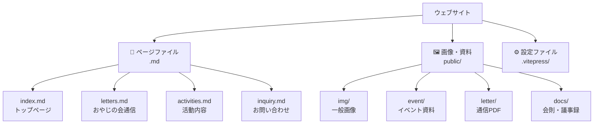
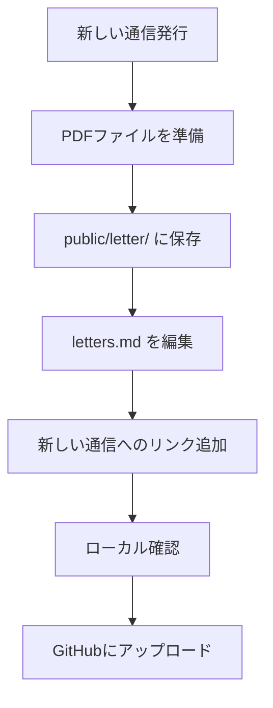
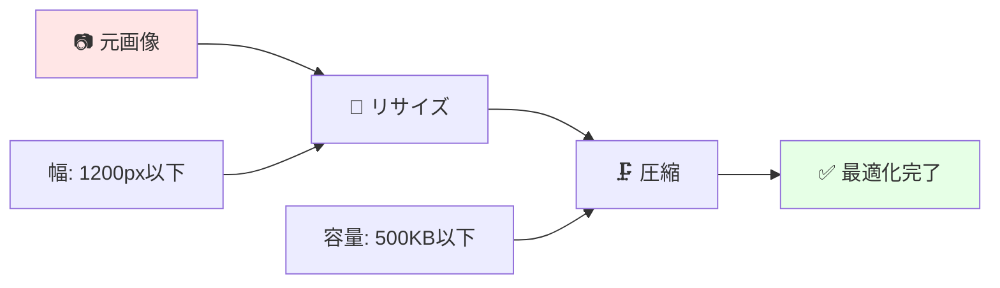
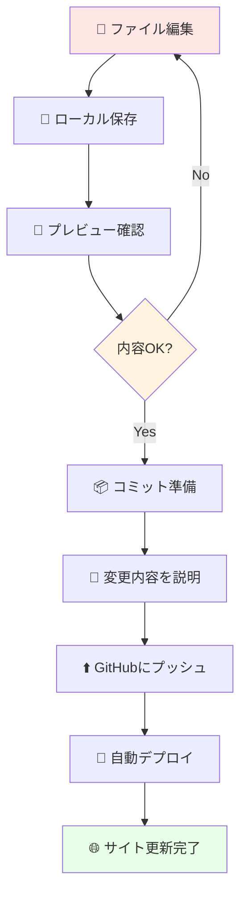
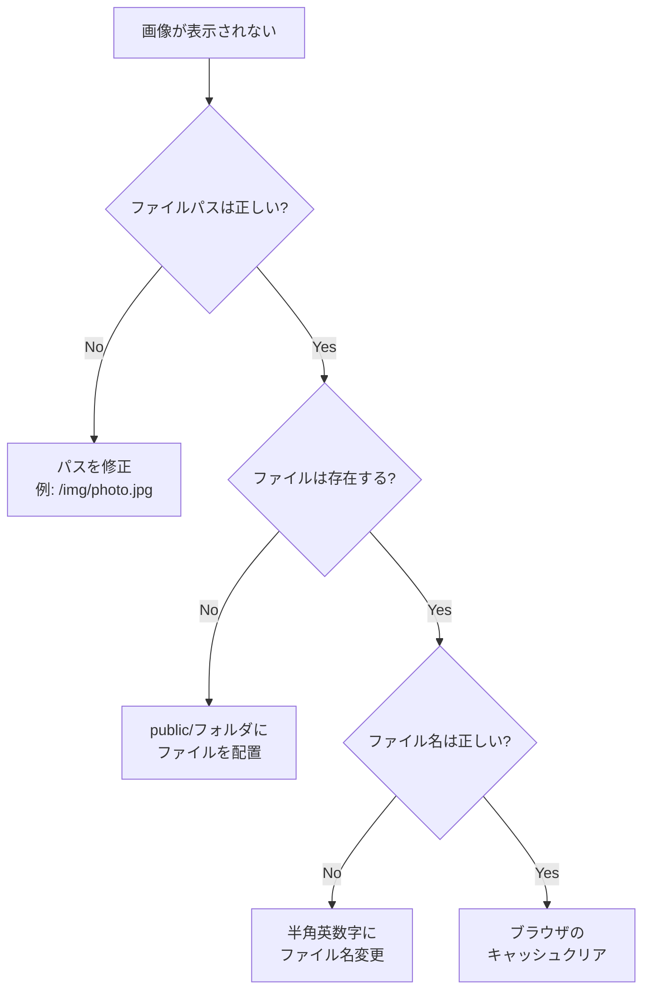

# コンテンツ更新ガイド

このガイドでは、ウェブサイトのページ内容や画像の更新方法を詳しく説明します。

## 🎯 このガイドで学べること

- 📝 既存ページの編集方法
- 🖼️ 画像の追加・管理
- 📄 PDFファイルの公開
- ✏️ マークダウン記法の使い方
- 💾 変更のアップロード方法

## 📁 ファイル構成の理解



### 🗂️ 主要ファイル一覧

| ファイル | 内容 | 更新頻度 |
|----------|------|----------|
| `index.md` | 🏠 トップページ | 🔵 中 |
| `letters.md` | 📰 おやじの会通信 | 🟢 高 |
| `activities.md` | 🎯 活動内容 | 🟡 低 |
| `minutes.md` | 📋 会則・議事録 | 🟡 低 |
| `inquiry.md` | 📞 お問い合わせ | 🔴 稀 |

## ✏️ マークダウン記法の基本

### 📝 見出し

```markdown
# 大見出し（H1）- ページタイトル用
## 中見出し（H2）- セクション用  
### 小見出し（H3）- サブセクション用
#### より小さい見出し（H4）
```

**表示例**:
# 大見出し（H1）
## 中見出し（H2）
### 小見出し（H3）

### 🎨 文字装飾

```markdown
**太字のテキスト**
*斜体のテキスト*
~~取り消し線~~
`コードやファイル名`
```

**表示例**:
- **太字のテキスト**
- *斜体のテキスト*
- ~~取り消し線~~
- `コードやファイル名`

### 📝 リスト

**箇条書きリスト**:
```markdown
- 項目1
- 項目2
  - サブ項目2-1
  - サブ項目2-2
- 項目3
```

**番号付きリスト**:
```markdown
1. 第一項目
2. 第二項目
3. 第三項目
```

### 🔗 リンクと画像

**リンク**:
```markdown
[リンクテキスト](https://example.com)
[内部ページへのリンク](/letters)
```

**画像**:
```markdown


<!-- サイズ指定付き画像 -->

```

### 📋 表（テーブル）

```markdown
| 項目 | 説明 | 備考 |
|------|------|------|
| 会費 | 年間1,000円 | 任意 |
| 活動日 | 土曜日 | 月1回 |
```

**表示例**:
| 項目 | 説明 | 備考 |
|------|------|------|
| 会費 | 年間1,000円 | 任意 |
| 活動日 | 土曜日 | 月1回 |

### 💬 引用文

```markdown
> これは引用文です。
> 重要な情報や
> 他からの引用に使用します。
```

**表示例**:
> これは引用文です。
> 重要な情報や
> 他からの引用に使用します。

## 📝 ページ編集の実践

### 🏠 トップページの編集

**ファイル**: `index.md`

**編集手順**:
1. VS Code で `index.md` を開く
2. 内容を編集
3. `Ctrl + S` で保存
4. ローカルサーバーで確認

**編集例**:
```markdown
---
layout: home
title: 松ケ丘小学校おやじの会
---

# 松ケ丘小学校おやじの会へようこそ！

## 🎯 私たちの活動

松ケ丘小学校の子どもたちの笑顔のために、
お父さんたちが協力して楽しい活動を企画・運営しています。

### 主な活動内容

- 🎪 **学校イベントのお手伝い**
  - 運動会の設営・片付け
  - 文化祭のサポート

- 🔧 **学校環境の整備**
  - 校庭の草刈り
  - 遊具のメンテナンス
```

### 📰 おやじの会通信の更新

**ファイル**: `letters.md`

**更新パターン**:



**編集例**:
```markdown
# おやじの会通信

## 📅 最新号

### Vol.4 2025年9月号
**発行日**: 2025年9月1日

今月の通信では、夏祭りの活動報告と秋のイベント予告をお届けします。

[📄 Vol.4をダウンロード (PDF)](/letter/from_oyaji_vol_4.pdf)

---

## 📚 バックナンバー

### Vol.3 2025年7月号
[📄 Vol.3をダウンロード (PDF)](/letter/from_oyaji_vol_3.pdf)

### Vol.2 2025年4月号  
[📄 Vol.2をダウンロード (PDF)](/letter/from_oyaji_vol_2.pdf)
```

## 🖼️ 画像の管理

### 📁 画像保存場所

```
public/
├── img/          🖼️ 一般的な画像
├── event/        🎪 イベント関連画像・資料
├── letter/       📰 おやじの会通信（PDF）
└── docs/         📋 会則・議事録（PDF）
```

### 📐 画像の最適化

**推奨設定**:



| 項目 | 推奨値 | 理由 |
|------|-------|------|
| **幅** | 1200px以下 | ページ表示速度 |
| **容量** | 500KB以下 | 読み込み時間短縮 |
| **形式** | JPG（写真）<br/>PNG（ロゴ・図） | 用途に応じた最適化 |

### 🛠️ 画像圧縮ツール

**オンラインツール（簡単）**:
1. **TinyPNG**: https://tinypng.com/
   - PNG・JPG両対応
   - ドラッグ&ドロップで簡単

2. **Squoosh**: https://squoosh.app/
   - Google製
   - 詳細設定可能

**使用手順**:
1. 上記サイトにアクセス
2. 画像ファイルをドラッグ&ドロップ
3. 圧縮後の画像をダウンロード
4. `public/img/` に保存

### 🖼️ 画像の追加手順

**手順**:
1. **画像を準備**
   - サイズ・容量を最適化
   - ファイル名を半角英数字に変更（例：`2025_summer_event.jpg`）

2. **適切なフォルダに保存**
   ```
   public/img/2025_summer_event.jpg
   ```

3. **マークダウンで表示**
   ```markdown
   
   ```

4. **プレビュー確認**
   - ローカルサーバーで表示確認

### 🚫 避けるべきファイル名

❌ **悪い例**:
```
夏祭り 2025.jpg          # 日本語・空白
summer festival.png      # 空白
イベント写真.jpeg        # 日本語
photo(1).jpg            # 括弧
```

✅ **良い例**:
```
2025_summer_festival.jpg
summer_event_photo.png
oyaji_meeting_2025.jpg
activity_photo_01.jpg
```

## 📄 PDFファイルの管理

### 📁 PDF保存場所

| 種類 | 保存先 | 例 |
|------|--------|---|
| 📰 通信 | `public/letter/` | `from_oyaji_vol_4.pdf` |
| 📋 会則・議事録 | `public/docs/` | `rule_2025.pdf` |
| 🎪 イベント資料 | `public/event/` | `2025_summer_festival.pdf` |

### 📎 PDFリンクの作成

```markdown
[📄 おやじの会通信 Vol.4](/letter/from_oyaji_vol_4.pdf)

[📋 会則（2025年版）](/docs/rule_2025.pdf)

[🎪 夏祭り案内](/event/2025_summer_festival.pdf)
```

## 💾 変更の保存とアップロード

### 🔄 基本ワークフロー



### 🐙 GitHub Desktop での操作

**手順**:
1. **GitHub Desktop を開く**
2. **変更ファイルを確認**
   - 左側に変更されたファイル一覧が表示
3. **変更内容を記述**
   - 下部の「Summary」に簡潔な説明を入力
   - 例：「おやじの会通信Vol.4を追加」
4. **コミット実行**
   - 「Commit to main」をクリック
5. **プッシュ実行**
   - 「Push origin」をクリック

### 💬 良いコミットメッセージの例

✅ **良い例**:
```
おやじの会通信Vol.4を追加
トップページの活動予定を更新
夏祭りイベント写真を追加
会則の誤字を修正
```

❌ **悪い例**:
```
更新
変更
修正
ファイル追加
```

### 🔍 VS Code での操作

**手順**:
1. **Source Control パネルを開く**
   - `Ctrl + Shift + G` (Windows) / `Cmd + Shift + G` (Mac)
2. **変更をステージング**
   - ファイル名の右側「+」をクリック
3. **コミットメッセージを入力**
   - 上部のテキストボックスに説明を記入
4. **コミット実行**
   - `Ctrl + Enter` (Windows) / `Cmd + Enter` (Mac)
5. **プッシュ実行**
   - 「...」メニュー → 「Push」

## ✅ 更新作業のチェックリスト

### 📝 編集前

- [ ] ローカルサーバーが起動している
- [ ] 最新版がローカルに同期されている
- [ ] バックアップが取られている

### ✏️ 編集中

- [ ] ファイル名が規則に従っている
- [ ] 画像サイズが適切である
- [ ] マークダウン記法が正しい
- [ ] リンクが機能している

### 💾 アップロード前

- [ ] ローカルでプレビュー確認済み
- [ ] エラーが発生していない
- [ ] コミットメッセージが明確
- [ ] 必要なファイルがすべて含まれている

### 🌐 アップロード後

- [ ] GitHub で変更が反映されている
- [ ] GitHub Actions が成功している
- [ ] 本番サイトで表示確認済み

## 🆘 よくある問題と解決方法

### ❌ 画像が表示されない

**原因と解決方法**:


### ❌ プレビューでエラーが出る

**よくあるエラーと解決方法**:

| エラー内容 | 原因 | 解決方法 |
|-----------|------|----------|
| `Failed to resolve import` | ファイルパス間違い | パスを確認・修正 |
| `Unexpected token` | マークダウン記法エラー | 記法を確認・修正 |
| `File not found` | ファイルが存在しない | ファイルの配置確認 |

### ❌ GitHubにプッシュできない

**解決方法**:
1. **権限確認**
   - GitHub アカウントが正しいか確認
   - リポジトリへのアクセス権限があるか確認

2. **競合解決**
   ```bash
   git pull origin main  # 最新版を取得
   # 競合があれば手動で解決
   git push origin main  # 再度プッシュ
   ```

## 🎯 次のステップ

基本的なコンテンツ更新をマスターしたら、お知らせ機能の管理について学びましょう：

➡️ [お知らせ管理ガイド](./04-announcements.md)
