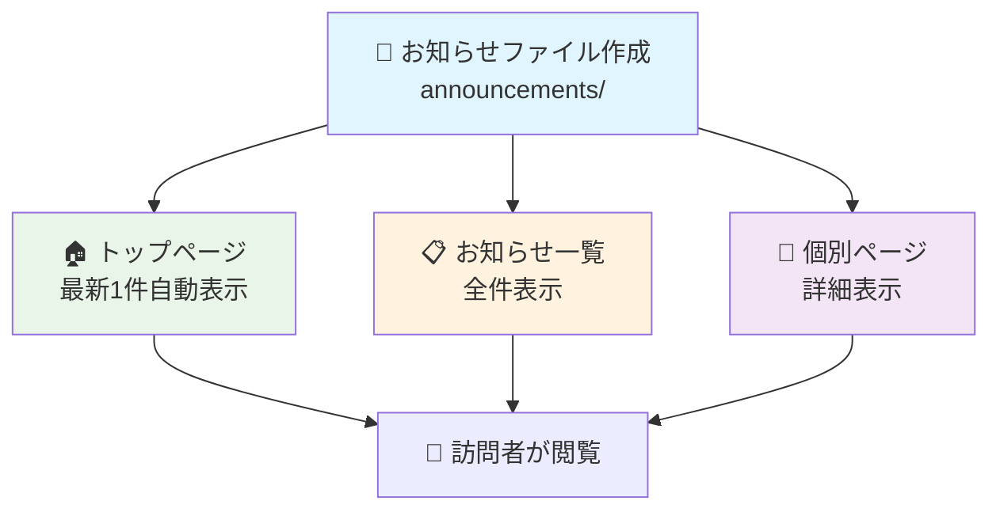
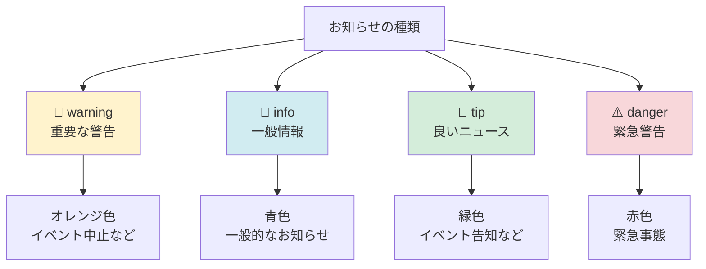
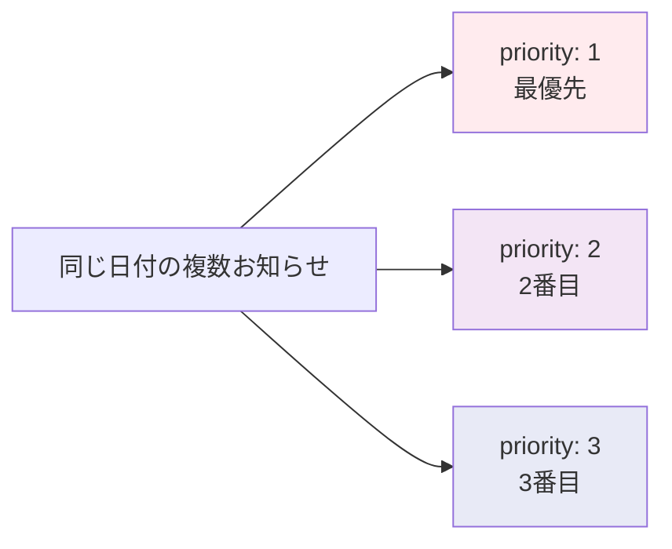
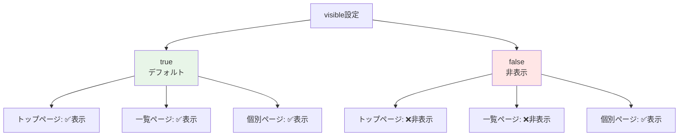
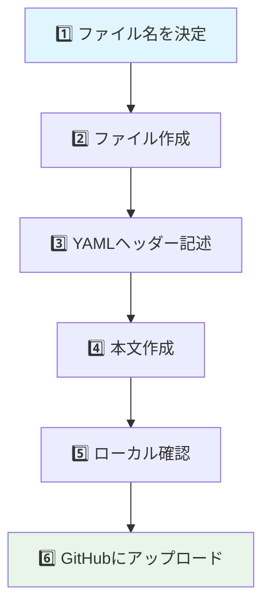
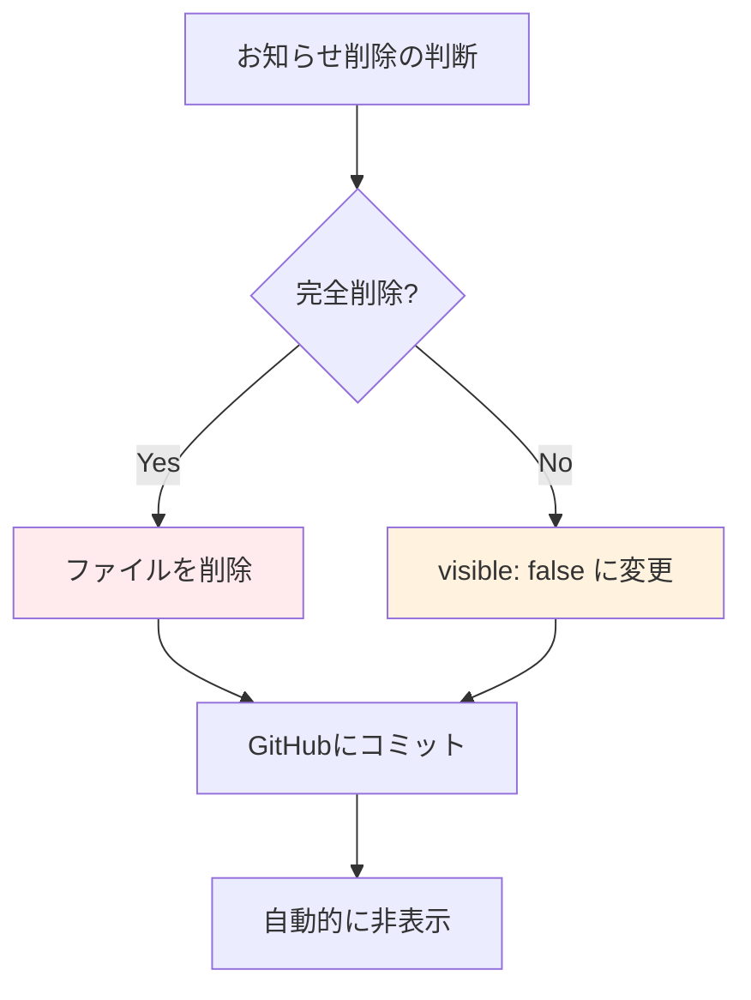
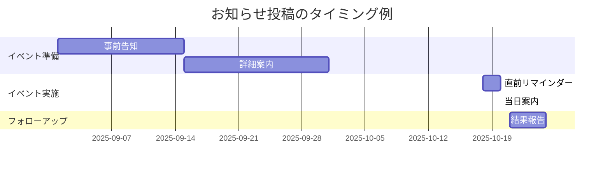
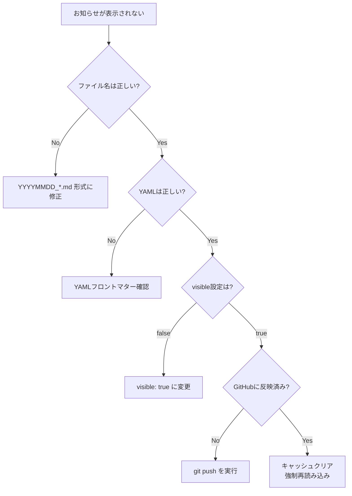

# お知らせ管理ガイド

このガイドでは、サイトのお知らせ機能の使い方を詳しく説明します。お知らせは自動的にトップページと一覧ページに表示される重要な機能です。

## 🎯 お知らせシステムの概要

### 🔄 お知らせの表示フロー



### 📍 表示場所と特徴

| 表示場所 | 件数 | 内容 | 用途 |
|----------|------|------|------|
| 🏠 **トップページ** | 最新1件 | タイトル + 概要 | 最新情報の告知 |
| 📋 **お知らせ一覧** | 全件 | タイトル + 概要 | 過去の履歴確認 |
| 📄 **個別ページ** | 1件 | 完全な内容 | 詳細情報の確認 |

## 📁 ファイル構成と命名規則

### 🗂️ 保存場所
```
announcements/
├── 20250801_natsu-matsuri-info.md      # 夏祭り情報
├── 20250301_member-recruitment.md      # 会員募集
├── 20250610_volunteer-work.md          # ボランティア募集
└── 20250915_autumn-event.md           # 秋イベント（新規作成例）
```

### 📝 ファイル命名規則

**パターン**: `YYYYMMDD_<内容キーワード>.md`

**良い例**:
```
20250801_natsu-matsuri-info.md       # 夏祭り情報
20250301_member-recruitment.md       # 会員募集  
20250415_event-cancel.md             # イベント中止
20250520_cleanup-volunteer.md       # 清掃ボランティア
20250701_pta-meeting.md              # PTA会議案内
```

**避けるべき例**:
```
announcement.md                      # 日付なし
2025-08-01_info.md                  # ハイフン使用
お知らせ.md                          # 日本語
20250801 event.md                   # 空白あり
```

## 📄 お知らせファイルの構造

### 🔧 基本構造

```markdown
---
date: YYYY-MM-DD          # お知らせの日付
time: "HH:MM"            # 時刻（オプション）
title: "お知らせのタイトル"   # お知らせのタイトル
type: "warning"          # お知らせの種類
priority: 1              # 優先度（同日内での順序）
visible: true            # 表示制御（オプション）
---

# お知らせのタイトル

お知らせの本文をここに記載します。

<!-- more -->

## 詳細情報

`<!-- more -->` より下の内容は詳細ページでのみ表示されます。
```

### 🏷️ お知らせの種類（type）



| タイプ | 色 | アイコン | 使用例 |
|--------|---|----------|--------|
| `warning` | 🟠 オレンジ | 🚨 | イベント中止、延期、重要変更 |
| `info` | 🔵 青 | 📢 | 一般的なお知らせ、案内 |
| `tip` | 🟢 緑 | 🎉 | イベント告知、良いニュース |
| `danger` | 🔴 赤 | ⚠️ | 緊急事態、至急対応必要 |

### 📊 優先度（priority）

同じ日付に複数のお知らせがある場合の表示順序を制御：



**例**:
```yaml
# 2025年8月1日のお知らせ複数件
---
date: 2025-08-01
title: "緊急：台風による夏祭り中止"
type: "danger"
priority: 1        # 最上位表示
---

---
date: 2025-08-01  
title: "夏祭り代替イベントのお知らせ"
type: "info"
priority: 2        # 2番目に表示
---
```

### 👁️ 表示制御（visible）



**用途例**:
- 📝 **下書き**: 作成中だが公開前
- 📚 **アーカイブ**: 過去の記録として保管
- 🧪 **テスト**: 動作確認用のサンプル

## ✍️ お知らせ作成の実践

### 🆕 新規お知らせの作成

**手順**:



**実際の作成例**:

1. **ファイル作成**
   ```
   announcements/20250915_autumn-festival.md
   ```

2. **内容記述**
   ```markdown
   ---
   date: 2025-09-15
   time: "10:00"
   title: "秋祭り開催のお知らせ"
   type: "tip"
   priority: 1
   ---

   # 🍂 秋祭り開催のお知らせ

   10月20日（日）に恒例の秋祭りを開催いたします！
   今年も楽しい企画をたくさん用意してお待ちしています。

   <!-- more -->

   ## 📅 開催概要

   - **日時**: 10月20日（日）10:00〜15:00
   - **場所**: 松ケ丘小学校 校庭
   - **参加費**: 無料
   - **雨天**: 体育館で開催

   ## 🎪 イベント内容

   ### 午前の部（10:00〜12:00）
   - 🏃‍♂️ 親子リレー
   - 🎯 射的ゲーム
   - 🍭 綿あめ作り体験

   ### 午後の部（13:00〜15:00）
   - 🎤 のど自慢大会
   - 🍜 焼きそば・たこ焼き販売
   - 🎁 お楽しみ抽選会

   ## 📞 お問い合わせ

   不明な点がございましたら、おやじの会までお気軽にお声がけください。

   皆様のご参加を心よりお待ちしております！
   ```

### ✏️ 既存お知らせの編集

**編集手順**:
1. VS Code で該当ファイルを開く
2. 内容を修正
3. 保存（`Ctrl + S`）
4. ローカルで確認
5. GitHubにアップロード

**よくある編集パターン**:

| 編集内容 | 修正場所 | 例 |
|----------|----------|---|
| 日時変更 | YAMLの`date`, `time` | `date: 2025-10-25` |
| タイトル変更 | YAMLの`title`と本文 | `title: "秋祭り延期のお知らせ"` |
| 緊急度変更 | YAMLの`type` | `type: "warning"` |
| 内容追加 | 本文セクション | 新しい見出しと内容を追加 |

### 🗑️ お知らせの削除

**削除方法**:



**完全削除**:
```bash
# ファイルを削除
rm announcements/20250801_old-announcement.md

# 変更をコミット
git add .
git commit -m "古いお知らせを削除"
git push
```

**非表示（推奨）**:
```yaml
---
date: 2025-08-01
title: "古いお知らせ"
type: "info"
visible: false    # 一覧からは非表示、URLアクセスは可能
---
```

## 🎨 高度な機能

### 📝 概要と詳細の分割

`<!-- more -->` マーカーを使用して、概要部分と詳細部分を分けることができます：

```markdown
---
date: 2025-09-15
title: "イベントのお知らせ"
type: "tip"
---

# イベントのお知らせ

10月にイベントを開催します！

詳細は以下をご確認ください。

<!-- more -->

## 詳細情報

ここから下は詳細ページでのみ表示されます。

### 会場詳細
- 住所: 〒xxx-xxxx ...
- アクセス: ...

### 注意事項
- 持ち物: ...
- 服装: ...
```

**表示の違い**:
- **トップページ/一覧**: `<!-- more -->` より上のみ表示 + 「続きを読む」リンク
- **詳細ページ**: 全内容を表示

### 🔗 内部リンクの活用

```markdown
# 関連情報

詳しくは以下のページもご覧ください：

- [活動内容について](/activities)
- [お問い合わせ](/inquiry)
- [過去の通信](/letters)
```

### 🖼️ 画像の埋め込み

```markdown
# イベントの様子


前回は300名を超える方にご参加いただきました！
```

## 📊 お知らせ管理のベストプラクティス

### ⏰ 投稿タイミング



| フェーズ | タイミング | 内容 | type |
|----------|------------|------|------|
| 📢 **事前告知** | 2-3週間前 | 日時・概要 | `tip` |
| 📋 **詳細案内** | 1週間前 | 詳細・準備事項 | `info` |
| ⏰ **リマインダー** | 前日 | 最終確認 | `warning` |
| 📝 **結果報告** | 開催後 | 活動報告・感謝 | `tip` |

### 🏷️ 効果的なタイトル

**良いタイトル例**:
```
✅ "10/20 秋祭り開催のお知らせ"       # 日付＋内容
✅ "緊急：台風による夏祭り中止"       # 緊急度明示
✅ "会員募集中！一緒に活動しませんか" # 行動呼びかけ
```

**避けるべきタイトル**:
```
❌ "お知らせ"                      # 内容不明
❌ "重要"                          # 具体性なし
❌ "イベントについて"               # 曖昧
```

### 📝 読みやすい本文作成

**構造化された文章**:
```markdown
# タイトル

## 📅 概要
- 日時：
- 場所：
- 対象：

## 📋 詳細内容
### サブ項目1
### サブ項目2

## 📞 お問い合わせ
```

## 🔍 よくある質問と解決方法

### ❓ Q: お知らせが表示されない

**A: 以下を確認してください**



### ❓ Q: 順序を変更したい

**A: 以下の方法で制御できます**

1. **日付で制御**（推奨）
   ```yaml
   date: 2025-09-16  # より新しい日付を設定
   ```

2. **優先度で制御**（同日内のみ）
   ```yaml
   date: 2025-09-15
   priority: 1       # 数字が小さいほど上位
   ```

### ❓ Q: 一時的に非表示にしたい

**A: visible設定を使用**
```yaml
---
date: 2025-09-15
title: "準備中のお知らせ"
visible: false    # 一覧では非表示
---
```

### ❓ Q: 緊急のお知らせを目立たせたい

**A: typeとpriorityを調整**
```yaml
---
date: 2025-09-15
title: "緊急：台風による影響について"
type: "danger"    # 赤色で強調
priority: 1       # 最優先表示
---
```

## ✅ お知らせ管理チェックリスト

### 📝 作成前
- [ ] ファイル名が規則に従っている
- [ ] 適切なtypeを選択している
- [ ] 必要に応じてpriorityを設定している

### ✏️ 作成中
- [ ] YAMLフロントマターが正しい
- [ ] タイトルが分かりやすい
- [ ] 必要に応じて画像を追加している
- [ ] `<!-- more -->`で概要と詳細を分けている

### 🚀 公開前
- [ ] ローカルでプレビュー確認済み
- [ ] 誤字脱字をチェック済み
- [ ] リンクが正しく動作する
- [ ] 適切な表示制御設定

### 📊 公開後
- [ ] 本番サイトで表示確認
- [ ] 必要に応じて他のメンバーに周知
- [ ] 定期的な見直し・更新

## 🎯 次のステップ

お知らせ管理をマスターしたら、サイトのデプロイについて学びましょう：

➡️ [デプロイガイド](./05-deployment.md)
