# デプロイガイド

このガイドでは、ローカルで編集した内容を本番サイトに公開する「デプロイ」について詳しく説明します。

## 🎯 デプロイとは

**デプロイ（Deploy）**: ローカルで作成・編集したファイルを、実際のウェブサイトに反映させる作業

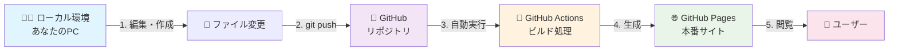

## 🔄 デプロイの種類

### 🤖 自動デプロイ（推奨・標準）

**仕組み**:
GitHubにファイルをプッシュすると、自動的にサイトが更新されます。

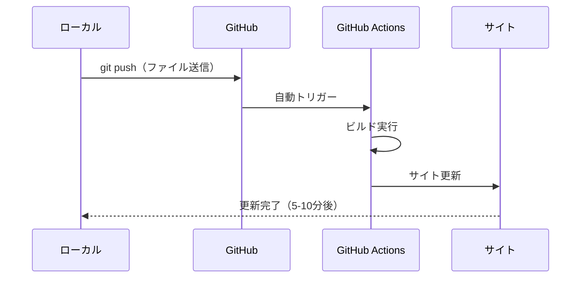

**メリット**:
- ✅ 手動作業不要
- ✅ エラー時の自動通知
- ✅ 履歴管理
- ✅ 複数人での協調作業

### 🖱️ 手動デプロイ

**使用場面**:
- 自動デプロイが失敗した場合
- 緊急時の強制更新
- デプロイタイミングの制御

## 📋 自動デプロイの流れ

### 1️⃣ ローカルでの作業

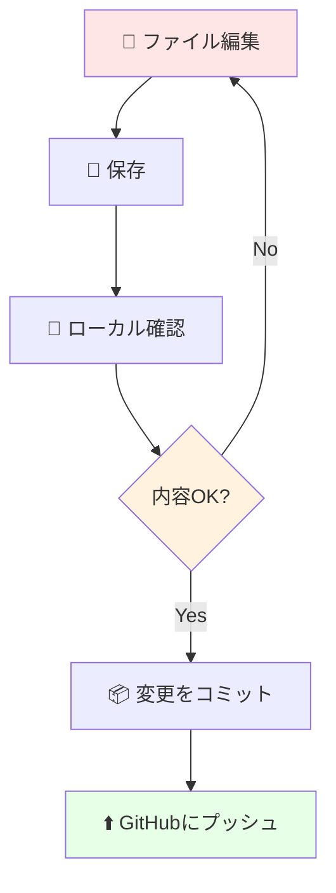

**具体的な操作**:
```bash
# 1. ファイル編集後、保存
# 2. ローカルサーバーで確認
npm run dev

# 3. 変更をステージング
git add .

# 4. コミット
git commit -m "お知らせを更新"

# 5. GitHubにプッシュ
git push origin main
```

### 2️⃣ GitHub Actionsの自動実行

**プッシュ後の流れ**:

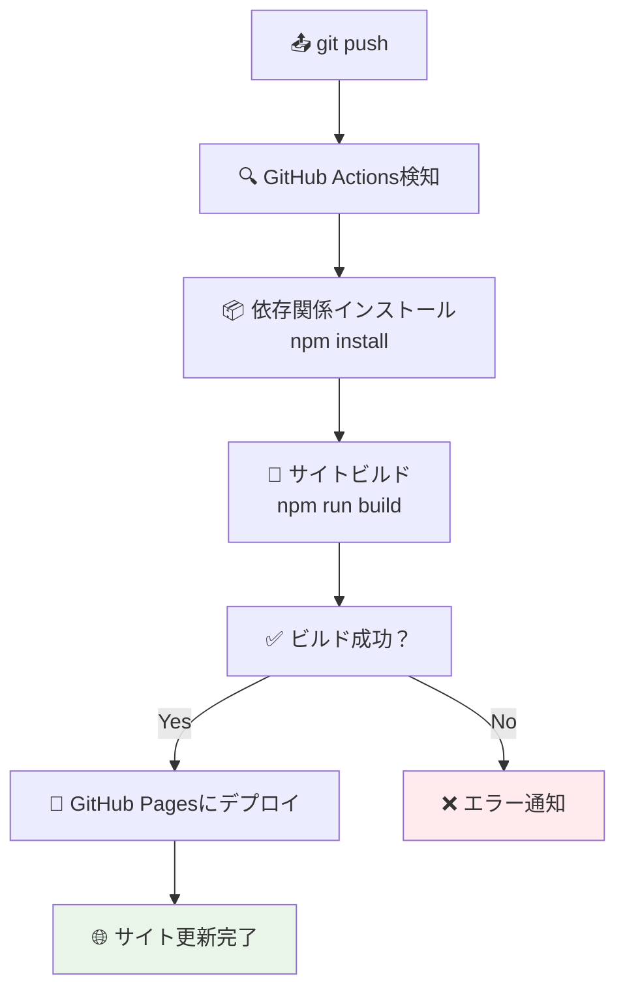

**所要時間**: 通常 5-10分

### 3️⃣ デプロイ状況の確認

**GitHub での確認方法**:

1. **リポジトリページにアクセス**
   ```
   https://github.com/matsu-oyaji/matsu-oyaji.github.io
   ```

2. **Actionsタブをクリック**
   - 実行中: 🟡 黄色の丸
   - 成功: ✅ 緑のチェック
   - 失敗: ❌ 赤のバツ

3. **詳細ログの確認**
   - 各ワークフローをクリックで詳細表示

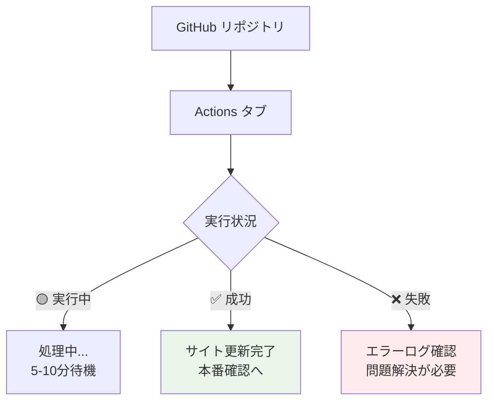

## 🖱️ 手動デプロイの方法

### 🌐 GitHub上での手動実行

**手順**:
1. GitHubリポジトリページにアクセス
2. 「Actions」タブをクリック
3. 左側の「Deploy」ワークフローを選択
4. 「Run workflow」ボタンをクリック
5. 「Run workflow」を再度クリックして実行

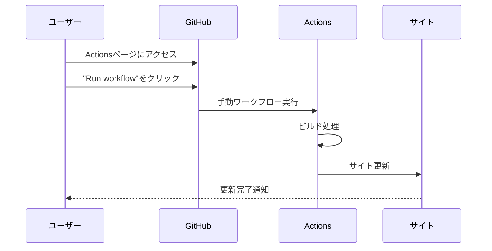

### 💻 ローカルからの手動ビルド

**事前確認用**（本番デプロイではない）:
```bash
# ビルドテスト実行
npm run build

# 成功時の表示例
✓ building client + server bundles...
✓ rendering pages...
build complete in 2.3s.
```

**用途**:
- エラーチェック
- ビルド時間の確認
- 生成ファイルの確認

## 📊 デプロイの監視とメンテナンス

### 🔍 ステータスの確認方法

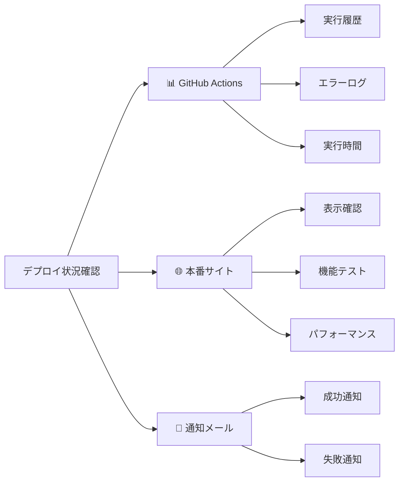

### 📈 デプロイ履歴の管理

**確認項目**:

| 項目 | 確認場所 | 頻度 |
|------|----------|------|
| **実行成功率** | GitHub Actions | 週次 |
| **実行時間** | Actions詳細 | 月次 |
| **エラー頻度** | Actions履歴 | 随時 |
| **サイト表示** | 本番URL | 更新時 |

### 📧 通知設定

**GitHub通知の活用**:
- デプロイ成功・失敗の通知
- プルリクエスト時の自動チェック
- セキュリティアラート

## 🚨 トラブルシューティング

### ❌ よくあるデプロイエラー

#### 1. ビルドエラー

**症状**: 
```
Error: Failed to resolve import "../announcements.data.js"
```

**原因と解決**:
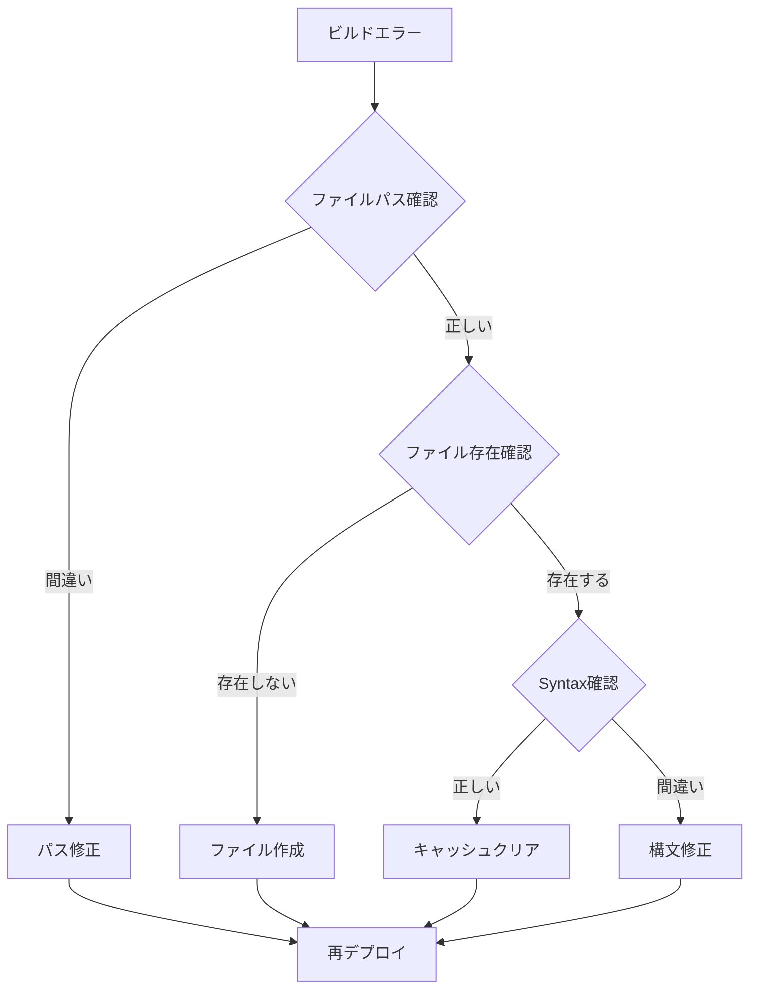

#### 2. メモリ不足エラー

**症状**:
```
Error: JavaScript heap out of memory
```

**解決方法**:
- 大きすぎる画像ファイルを圧縮
- 不要なファイルを削除
- ビルド設定の最適化

#### 3. 権限エラー

**症状**:
```
Error: Permission denied (403)
```

**解決方法**:
1. GitHub Pagesの設定確認
2. リポジトリの権限確認
3. Actions の権限設定確認

### 🔧 エラー解決の手順

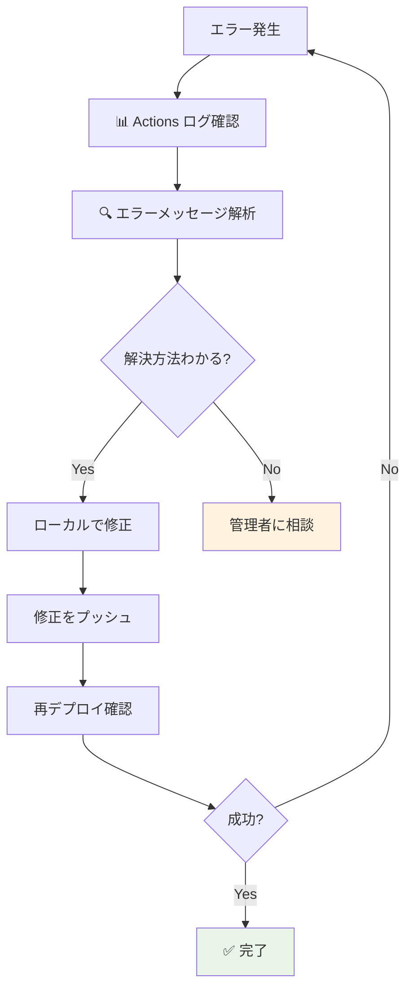

### 🆘 緊急時の対応

**サイトが表示されない場合**:

1. **即座に確認**
   ```bash
   # 本番サイトにアクセス
   curl -I https://matsu-oyaji.github.io/
   ```

2. **前のバージョンに戻す**
   ```bash
   # 直前のコミットに戻す
   git revert HEAD
   git push origin main
   ```

3. **管理者への報告**
   - エラーの発生時刻
   - 実行した操作
   - エラーメッセージのスクリーンショット

## 📋 デプロイのベストプラクティス

### ⏰ デプロイのタイミング

```mermaid
gantt
    title 推奨デプロイスケジュール
    dateFormat  HH:mm
    section 平日
    作業可能時間    :09:00, 17:00
    推奨時間帯     :10:00, 16:00
    section 休日
    緊急時のみ     :09:00, 18:00
```

| 時間帯 | 推奨度 | 理由 |
|--------|--------|------|
| **平日 10-16時** | ✅ 推奨 | 問題時の対応可能 |
| **平日 朝・夕** | 🟡 注意 | 訪問者多い時間 |
| **休日** | ❌ 避ける | サポート対応困難 |

### 📝 変更管理

**コミットメッセージの規則**:
```bash
✅ 良い例:
git commit -m "お知らせ: 秋祭りの案内を追加"
git commit -m "修正: 連絡先の電話番号を更新"
git commit -m "画像: イベント写真を追加"

❌ 悪い例:
git commit -m "更新"
git commit -m "修正"
git commit -m "追加"
```

### 🧪 テスト手順

**デプロイ前チェックリスト**:

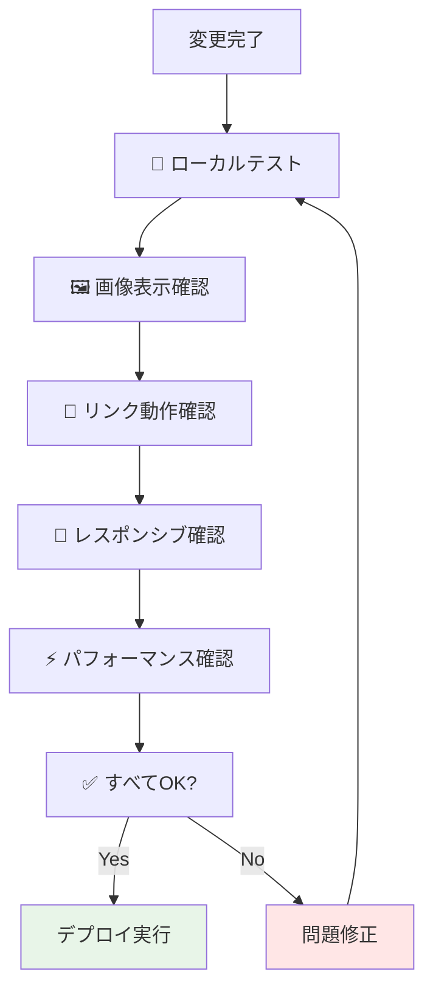

| チェック項目 | 確認方法 | ✅ |
|-------------|----------|---|
| ローカル表示 | `npm run dev` | ⬜ |
| ビルド成功 | `npm run build` | ⬜ |
| 画像表示 | 各ページの画像確認 | ⬜ |
| リンク動作 | クリックテスト | ⬜ |
| スマホ表示 | 開発者ツールで確認 | ⬜ |

### 🔄 定期メンテナンス

**月次作業**:
- [ ] デプロイ履歴の確認
- [ ] エラー率の分析
- [ ] パフォーマンスの監視
- [ ] セキュリティ更新の確認

**年次作業**:
- [ ] 依存関係の更新
- [ ] Node.js バージョンの確認
- [ ] GitHub Actions の設定見直し

## 📊 デプロイ実績の記録

### 📈 追跡指標

| 指標 | 目標値 | 確認方法 |
|------|--------|----------|
| **成功率** | 95%以上 | GitHub Actions |
| **実行時間** | 10分以内 | Actions ログ |
| **エラー復旧時間** | 30分以内 | 記録管理 |
| **サイト可用性** | 99%以上 | 外部監視ツール |

### 📝 記録テンプレート

```markdown
## デプロイ記録 - YYYY/MM/DD

### 📋 基本情報
- 実行者: [名前]
- 開始時刻: HH:MM
- 完了時刻: HH:MM
- 対象: [変更内容の概要]

### ✅ 結果
- [ ] デプロイ成功
- [ ] 機能確認完了
- [ ] パフォーマンス確認

### 📝 備考
[特記事項があれば記載]
```

## 🎯 次のステップ

デプロイをマスターしたら、問題解決のためのトラブルシューティングについて学びましょう：

➡️ [トラブルシューティング](./06-troubleshooting.md)
