# トラブルシューティング

このガイドでは、ウェブサイト運用中に遭遇する可能性のある問題と、その解決方法を詳しく説明します。

## 🎯 問題解決のアプローチ

### 🔍 問題診断のフローチャート

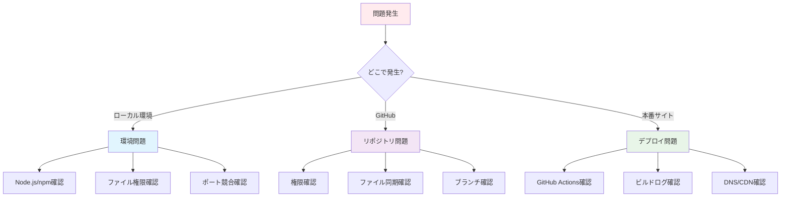

### 🛠️ 基本的な解決手順

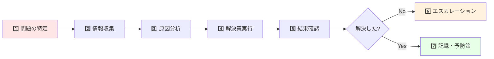

## 🖥️ ローカル環境の問題

### ❌ Node.js / npm の問題

#### 問題1: "node が認識されません"

**症状**:
```bash
$ node --version
'node' は、内部コマンドまたは外部コマンド、
操作可能なプログラムまたはバッチ ファイルとして認識されていません。
```

**解決方法**:

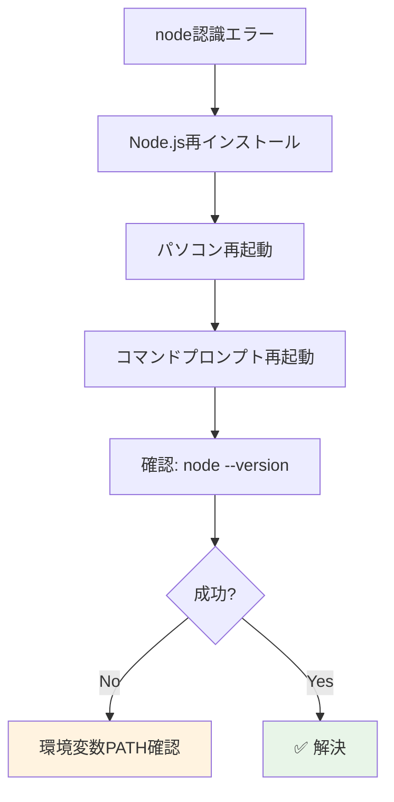

**詳細手順**:
1. **Node.js を再インストール**
   - https://nodejs.org/ から最新LTS版をダウンロード
   - 既存バージョンをアンインストール後、新規インストール

2. **パソコンを再起動**

3. **確認**
   ```bash
   node --version
   npm --version
   ```

#### 問題2: npm install でエラー

**症状**:
```bash
$ npm install
npm ERR! code EACCES
npm ERR! errno -13
npm ERR! Error: EACCES: permission denied
```

**解決方法（OS別）**:

**Windows**:
```bash
# 管理者としてコマンドプロンプトを実行
npm install
```

**Mac**:
```bash
# 権限を付与して実行
sudo npm install
```

**根本的解決（推奨）**:
```bash
# npmのグローバルディレクトリを変更
npm config set prefix '~/.npm-global'
export PATH=~/.npm-global/bin:$PATH
```

### ❌ ローカルサーバーの問題

#### 問題3: "Port 5173 is already in use"

**症状**:
```bash
$ npm run dev
Error: Port 5173 is already in use
```

**解決方法**:

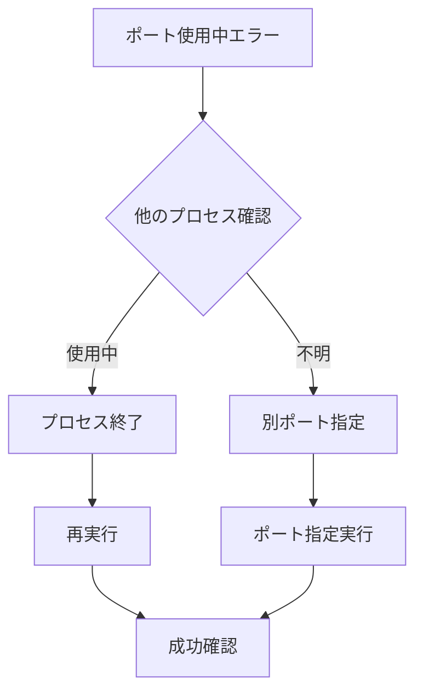

**具体的手順**:

1. **使用中プロセスの確認**
   ```bash
   # Windows
   netstat -ano | findstr :5173
   
   # Mac/Linux
   lsof -i :5173
   ```

2. **プロセス終了**
   ```bash
   # Windows（PIDを指定）
   taskkill /PID <プロセスID> /F
   
   # Mac/Linux
   kill -9 <プロセスID>
   ```

3. **別ポートで起動**
   ```bash
   npm run dev -- --port 3000
   ```

#### 問題4: ページが表示されない

**症状**:
```
This site can't be reached
localhost refused to connect
```

**チェックリスト**:

| 確認項目 | コマンド/手順 | ✅ |
|----------|---------------|---|
| サーバー起動中？ | `npm run dev` が実行中か確認 | ⬜ |
| ポート番号正しい？ | URL: http://localhost:5173/ | ⬜ |
| ファイアウォール？ | セキュリティソフトの設定確認 | ⬜ |
| ブラウザキャッシュ？ | Ctrl+F5 で強制再読み込み | ⬜ |

### ❌ ファイル編集の問題

#### 問題5: 文字化けが発生

**症状**:
- 日本語が「???」や「■」で表示される
- 編集時に文字が崩れる

**解決方法**:

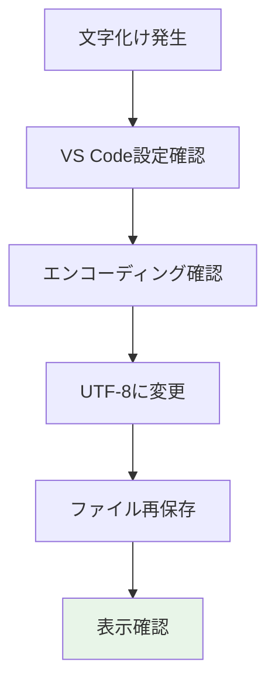

**VS Code での設定**:
1. 右下の文字エンコーディング表示をクリック
2. 「UTF-8」を選択
3. 「Save with Encoding」を選択
4. ファイルを保存し直す

## 📁 GitHub の問題

### ❌ 認証・権限の問題

#### 問題6: "Permission denied (publickey)"

**症状**:
```bash
$ git push origin main
git@github.com: Permission denied (publickey).
fatal: Could not read from remote repository.
```

**解決方法**:

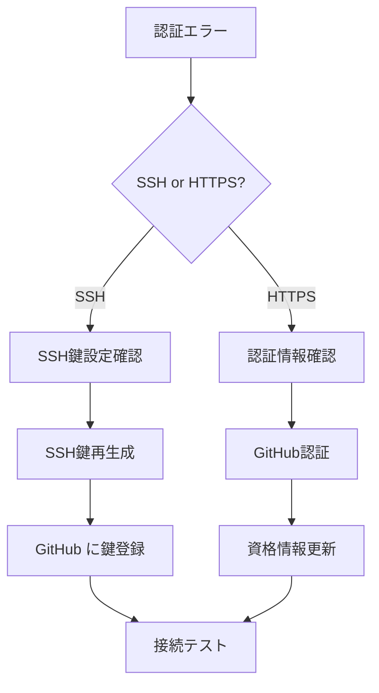

**HTTPS認証の場合（推奨）**:
```bash
# リモートURLをHTTPSに変更
git remote set-url origin https://github.com/matsu-oyaji/matsu-oyaji.github.io.git

# 認証情報をクリア（Windows）
git config --global --unset credential.helper
```

#### 問題7: "Repository not found"

**症状**:
```bash
$ git clone https://github.com/matsu-oyaji/matsu-oyaji.github.io.git
Cloning into 'matsu-oyaji.github.io'...
remote: Repository not found.
fatal: repository 'https://github.com/matsu-oyaji/matsu-oyaji.github.io.git/' not found
```

**確認事項**:
1. **URL が正しいか**
2. **GitHub アカウントでログインしているか**
3. **リポジトリへのアクセス権限があるか**

**解決手順**:
1. ブラウザで該当URLにアクセスし、リポジトリが存在するか確認
2. GitHub にログインしているか確認
3. 管理者にアクセス権限の付与を依頼

### ❌ 同期の問題

#### 問題8: "Your branch is behind"

**症状**:
```bash
$ git status
Your branch is behind 'origin/main' by 3 commits, and can be fast-forwarded.
```

**解決方法**:
```bash
# 最新の変更を取得
git pull origin main

# 競合がある場合は手動で解決後
git add .
git commit -m "競合解決"
git push origin main
```

#### 問題9: 競合（Conflict）が発生

**症状**:
```bash
$ git pull origin main
Auto-merging index.md
CONFLICT (content): Merge conflict in index.md
Automatic merge failed; fix conflicts and then commit the result.
```

**解決手順**:

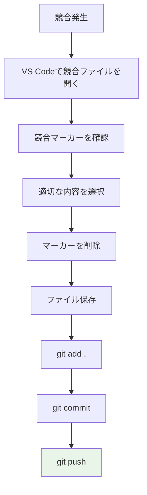

**競合マーカーの例**:
```markdown
<<<<<<< HEAD
# 古いタイトル
=======
# 新しいタイトル
>>>>>>> origin/main
```

**解決後**:
```markdown
# 新しいタイトル
```

## 🌐 本番サイトの問題

### ❌ デプロイの問題

#### 問題10: GitHub Actions が失敗

**症状**:
- Actions タブで赤い❌マークが表示
- サイトが更新されない

**確認手順**:

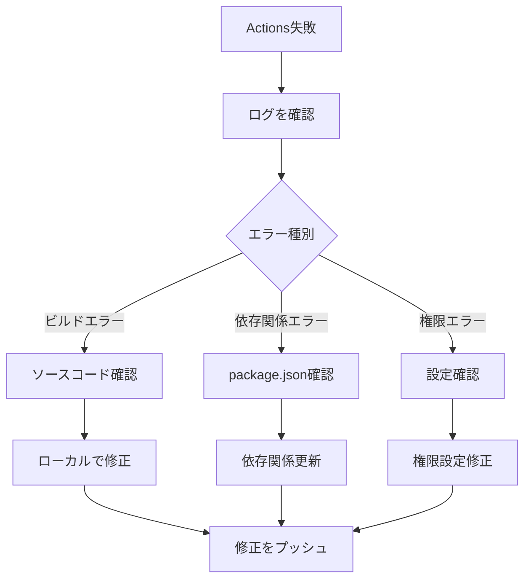

**よくあるエラーと解決方法**:

| エラー内容 | 原因 | 解決方法 |
|-----------|------|----------|
| `Module not found` | ファイルパス間違い | パスを修正 |
| `Syntax error` | 記法エラー | マークダウン記法確認 |
| `Build failed` | 依存関係問題 | npm install を実行 |
| `Permission denied` | 権限不足 | GitHub設定確認 |

#### 問題11: サイトが更新されない

**チェックフロー**:

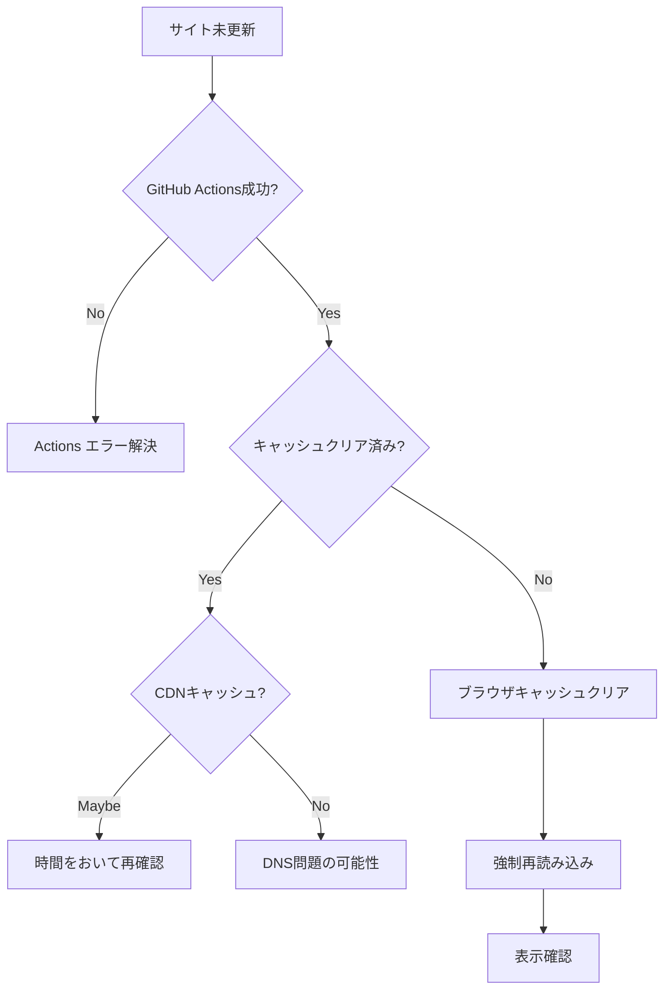

**ブラウザキャッシュクリア方法**:
- **Windows**: `Ctrl + F5`
- **Mac**: `Cmd + Shift + R`
- **Chrome**: `Ctrl + Shift + Delete`

### ❌ 表示の問題

#### 問題12: 画像が表示されない

**原因分析チェックリスト**:

| 確認項目 | チェック方法 | ✅ |
|----------|-------------|---|
| ファイル存在 | `public/` フォルダ内の確認 | ⬜ |
| パス記述 | Markdown内のパス確認 | ⬜ |
| ファイル名 | 大文字小文字、特殊文字 | ⬜ |
| ファイル形式 | jpg, png, gif 等 | ⬜ |
| ファイルサイズ | 大きすぎないか | ⬜ |

**修正例**:
```markdown
❌ 間違い:


✅ 正しい:

```

#### 問題13: レイアウトが崩れる

**よくある原因と解決方法**:

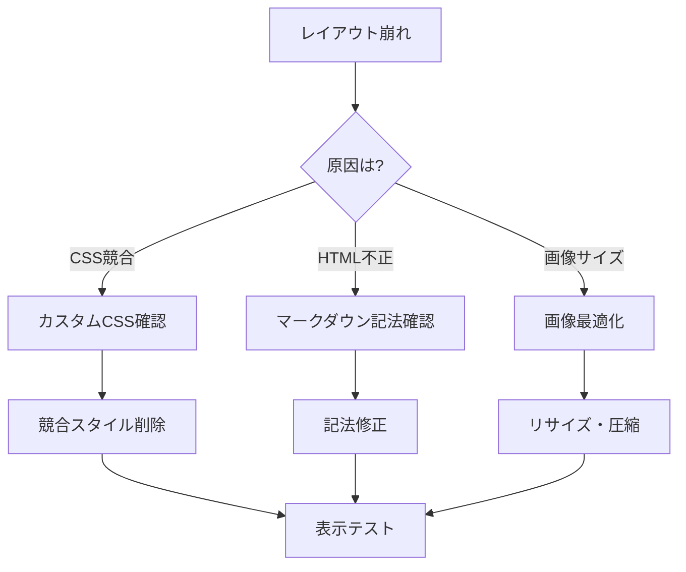

## 🔧 予防・メンテナンス

### 📋 定期チェック項目

#### 週次チェック
- [ ] サイトの表示確認
- [ ] 新しいお知らせの確認
- [ ] GitHub Actions の実行状況
- [ ] エラーログの確認

#### 月次チェック
- [ ] パフォーマンステスト
- [ ] セキュリティ更新の確認
- [ ] バックアップの確認
- [ ] 依存関係の更新チェック

#### 年次チェック
- [ ] Node.js バージョン更新
- [ ] VitePress バージョン更新
- [ ] GitHub Actions ワークフロー見直し
- [ ] ドメイン設定の確認

### 🛡️ バックアップ戦略

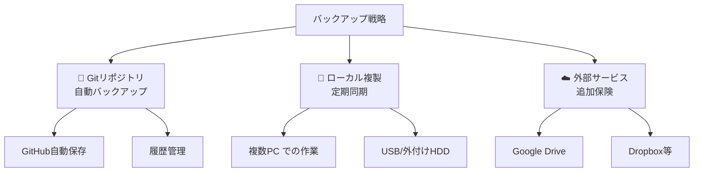

### 📊 パフォーマンス監視

**監視項目**:

| 項目 | 目標値 | 確認方法 |
|------|--------|----------|
| **ページ読み込み時間** | 3秒以内 | PageSpeed Insights |
| **画像最適化率** | 80%以上 | DevTools Network |
| **Lighthouse スコア** | 90以上 | Chrome DevTools |
| **モバイル対応** | 100% | モバイルフレンドリーテスト |

**確認ツール**:
- [PageSpeed Insights](https://pagespeed.web.dev/)
- [GTmetrix](https://gtmetrix.com/)
- Chrome DevTools

## 🆘 エスカレーション

- Chrome DevTools

## � 参考資料

### 📱 緊急連絡体制

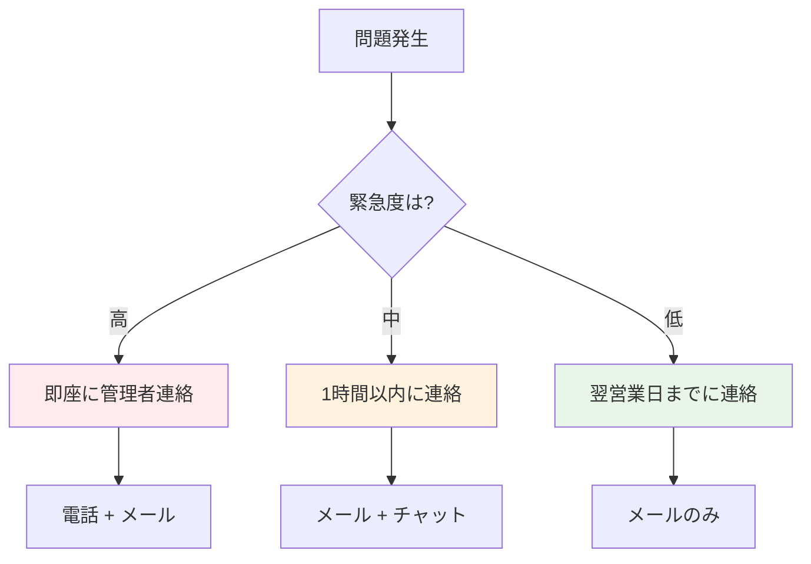

**緊急度の判定**:
- **高**: サイト全体がダウン、セキュリティ問題
- **中**: 一部機能が動作しない、表示異常
- **低**: 軽微な表示問題、改善要望

## 📚 参考資料

### 🔗 公式ドキュメント
- [VitePress 公式ドキュメント](https://vitepress.dev/)
- [GitHub Pages ドキュメント](https://docs.github.com/pages)
- [Node.js 公式サイト](https://nodejs.org/)
- [Git 公式ドキュメント](https://git-scm.com/doc)

### 🛠️ ツール・サービス
- [GitHub Desktop](https://desktop.github.com/)
- [VS Code](https://code.visualstudio.com/)
- [TinyPNG（画像圧縮）](https://tinypng.com/)

### 📖 学習リソース
- [Markdown チートシート](https://github.com/adam-p/markdown-here/wiki/Markdown-Cheatsheet)
- [Git 入門](https://learngitbranching.js.org/?locale=ja)

---

## 💡 まとめ

トラブルシューティングで最も大切なことは：

1. **🔍 冷静に問題を分析する**
2. **📝 実行した手順を記録する**  
3. **🤝 困った時は早めに相談する**
4. **📚 解決方法を記録・共有する**

問題は成長の機会です。一つずつ解決していくことで、運用スキルが向上します！

---

*このガイドは継続的に更新されます。新しい問題や解決方法があれば追加していきましょう。*
